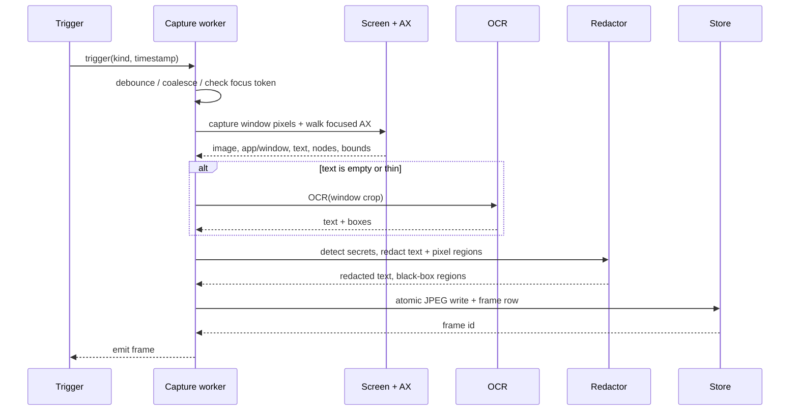

# Plan — Focused-App Capture SDK

> Working name: **Goku Capture SDK**. The open decisions in §19 were locked on 2026-11-16. D1 is macOS and Windows, which overrides the earlier "macOS only" recommendation. D2 through D19 keep the recommendation in that table. D20 (license) is still unset. Do not add a LICENSE file until the operator picks one.

---

## 1. Goal

Build an embeddable SDK that lets any desktop app (Electron, Tauri, or plain Rust/Node) record a **searchable, privacy-safe memory of the focused application**:

- `start()` / `stop()` a capture session.
- Take a screenshot **only of the focused application/window**.
- Take screenshots **on user events** (app switch, window focus, click, typing pause, scroll stop, idle, manual).
- Extract **accessibility text first, OCR as fallback**.
- **Redact secrets** before persisting text or pixels.
- Query **recent frames** directly from the SDK.
- No server, no HTTP, no sockets. Everything in-process.
- First-class permission management APIs.

### Non-goals for v1

- Video/MP4 recording, audio, transcription, meetings.
- Full-monitor capture of every display.
- Search UI, semantic search, embeddings, AI agents, pipes, workflows.
- Cloud sync, auth, orgs, telemetry.
- Screenpipe DB compatibility.
- Linux.

### The three decisions that shape everything

1. **What "focused application" means** — display crop, app-filtered display crop, or window-only capture (§4). This determines privacy, fidelity, and how much platform code we write.
2. **What "secrets redacted" means** — text only, text + AX-mapped pixels, or text + always-OCR pixel redaction (§7). This determines cost, battery, and whether we can honestly promise redaction.
3. **Platform scope** — macOS-only v1, or macOS + Windows at launch (§13). This roughly doubles the capture/AX/OCR work.

Everything else is config and API detail.

### Why not just use the Screenpipe SDK?

| Reason | Detail |
|---|---|
| License | Screenpipe is source-available under a commercial license, not a permissive OSS license. |
| Wrong default product | The SDK records MP4 by default. Paired snapshot capture is an opt-in side path behind `dataDir`. |
| Wrong capture scope | It captures the full monitor and attaches the focused AX tree to it. Focused-window mode is not exposed in the SDK. |
| Wrong redaction | Text-only regex at capture time; image redaction is a separate heavy model + background worker. |
| Missing APIs | No recent-frames query, no health/diagnostics, weak permission API (screen + microphone only). |
| Baggage | ffmpeg, audio, telemetry, server-adjacent deps, enterprise plumbing. |
| DB lock-in | Its 30+ table schema and migration history, not our minimal one. |

We want the *idea*, not the dependency.

---

## 2. Product shape

```
Host app (Electron main process / Tauri Rust / Node)
        │
        ▼
┌────────────────────────────────────────────────────────────┐
│ Goku SDK                                                    │
│                                                            │
│  Recorder (start / stop / pause / resume / captureNow)      │
│  Query API (recentFrames / frame / frameImage / diagnose)   │
│  Permission API (status / request / openSettings / onChange)│
│  Events (frame / state / permission / error / degraded)     │
└───────────────────────┬────────────────────────────────────┘
                        │ in-process
┌───────────────────────▼────────────────────────────────────┐
│ Core engine (Rust)                                          │
│                                                             │
│  focus watcher ──► trigger queue ──► capture worker          │
│                                          │                  │
│                                          ├─ window screenshot│
│                                          ├─ AX tree walk     │
│                                          ├─ OCR fallback     │
│                                          ├─ secret redaction │
│                                          ├─ JPEG write       │
│                                          └─ SQLite row       │
│                                                             │
│  permission watcher   retention worker   status/diagnostics  │
└─────────────────────────────────────────────────────────────┘
```

One active `Recorder` per process. Global event taps and AX observers are process-wide, so multiple concurrent recorders would fight. Enforce with a singleton guard and a clear error.

---

## 3. Proposed architecture

### 3.1 Crates

```
goku/
  crates/
    goku-types/        # shared types, config, errors, events
    goku-permissions/  # OS permission state/request/settings, watcher
    goku-capture/      # screen capture backends + focused window resolution
    goku-a11y/         # AX/UIA tree extraction + focus metadata
    goku-ocr/          # OCR trait + Apple/Windows/fallback backends
    goku-redact/       # secret detection + text/pixel redaction
    goku-store/        # SQLite index + JPEG/thumbnail files + retention
    goku-core/         # Recorder orchestration, triggers, workers, query API
  bindings/
    node/              # napi-rs addon (@goku/recorder)
    electron/          # main-process helper + preload + renderer bridge
    tauri/             # tauri-plugin-goku (commands, events, permissions)
  examples/
    electron-app/
    tauri-app/
    rust-cli/
  docs/
```

We can collapse crates later if compile times or API friction demand it. The boundaries matter more than the count: capture, a11y, OCR, redaction, storage, permissions can each be tested and swapped independently.

**For v1, start smaller.** A realistic minimum is:
- `goku-core` — one crate with internal modules (`capture`, `a11y`, `ocr`, `redact`, `store`, `permissions`, `triggers`).
- `bindings/node` — napi addon.
- `bindings/tauri` — Tauri plugin.

Split into separate crates only when compile times, feature flags, or platform-specific dependencies force it. Eight crates on day one is architecture theatre; one well-moduled crate is faster to ship and easier to refactor.

### 3.2 Core loop

```
Triggers:
  NSWorkspace app switch
  AXObserver window focus
  CGEventTap click / key / scroll (listen-only)
  Clipboard change (optional)
  Idle timer
  Manual captureNow()
        │
        ▼
  Trigger queue (bounded, coalescing)
        │
        ▼
  Capture worker (single, serialized)
    1. Resolve focus token: pid, app, bundle, window title, window rect, display
    2. Wait a settle delay (app switch 150ms, click 80ms, typing/scroll already debounced)
    3. Capture window-scoped pixels
    4. Walk focused window AX tree (parallel or sequential, bounded)
    5. Verify focus token did not change; otherwise discard or mark incoherent
    6. Decide text source; run OCR if needed
    7. Detect secrets; redact text; redact pixel regions
    8. Encode JPEG (full + optional thumb) atomically
    9. Insert frame row (single writer)
   10. Emit `frame`
```

Key rule: **the capture worker never waits for optional enrichment.** If OCR or redaction would exceed the latency budget, write the frame with `text_status = pending` and finish enrichment asynchronously — but only if pixel redaction is off. If pixel redaction is on, the image is written to a temp file and moved into place only after redaction. See §7.4.

**Focus coherence:** read a focus token (pid, bundle id, window title, window rect, display) before and after the pixels + AX walk. If it changed, discard the capture and record `focus_incoherent` — never attach the old AX tree or app identity to new pixels. This is the class of bug that produces "the search result shows the wrong window" and it is worth the extra read.



### 3.3 Concurrency

| Component | Model |
|---|---|
| Trigger listeners | OS callbacks / dedicated threads; push into a bounded queue |
| Capture worker | One serialized async task; coalesces bursts |
| AX walker | Dedicated blocking thread per focused PID, hard timeout, replace on hang |
| OCR | Blocking pool, semaphore = 1 |
| Redaction | Same thread as capture (fast, <5ms) or blocking pool if needed |
| JPEG encode | Blocking pool |
| DB writer | One dedicated thread with a command channel |
| Permission watcher | Poll every 2–5s while recording; eager reports from capture errors |
| Retention | Timer at start + hourly |

Never block an OS callback. Never hold a mutex across a native call.

---

## 4. Capture scope — the core decision

"Only the focused application" can mean three different things. We should support all three, with one default.

### Option A — Display crop

Capture the display containing the focused window, crop to the window's bounds.

- **Pros:** exactly what the user sees, including overlapping same-app popovers/menus; simple coordinate math; works with one screenshot API.
- **Cons:** pixels of other apps inside the window rect are captured (e.g., a system dialog over the window).
- **Best for:** fidelity/debug mode.

### Option B — Display + focused-app filter + crop (recommended default)

Capture the display with a ScreenCaptureKit content filter that includes only the focused app's windows (other apps excluded at the compositor), then crop to the focused window.

- **Pros:** what the user sees of *that app*; other apps never enter the stored pixels; most same-app popovers/panels included; no post-hoc masking needed.
- **Cons:** slightly more setup (map AX pid → SCApplication); other-app overlays are black; system-level menus may be separate windows; more platform-specific code.
- **Best for:** the default privacy + fidelity trade-off.

### Option C — Window-only capture

Capture the focused window's own surface by window ID.

- **Pros:** strongest isolation; ignores occlusion.
- **Cons:** ignores clipping/occlusion (not "what the user saw"); child windows/popovers can be missed; window ID ↔ AX window mapping is brittle.
- **Best for:** strict "app content only" mode.

**Proposal:** `scope: 'focusedApp'` (Option B) default, `scope: 'focusedWindow'` (Option C) strict, `scope: 'displayCrop'` (Option A) fidelity. All produce a window-sized image, not a black-masked full-monitor image. We store `windowRect` + `scale` in the row so coordinates can be mapped back.

Option B is a ScreenCaptureKit content filter. Windows Graphics Capture can capture a window or a monitor. It cannot include only one application's windows in a display capture. On Windows, `focusedApp` falls back to `focusedWindow` and the status records the fallback. `displayCrop` on Windows can include other apps' pixels. `SetWindowDisplayAffinity(WDA_EXCLUDEFROMCAPTURE)` is an opt-out a window sets on itself. It is not a substitute for Option B.

### Multi-display

v1: capture only the display with the largest intersection with the focused window. If the window spans displays, clip and mark `clipped: true`. Do not capture all monitors.

### What about menus, dialogs, and popovers?

- Option B usually includes same-app windows that overlap the focused window rect, including most app-owned popovers and panels. System-level menu bar/dropdowns may be separate windows; validate per app in Phase 0.
- Option C includes child windows only if the backend supports it (macOS 14.2+ SCK child-window inclusion). Otherwise strict mode may miss them.
- This is a reason B is the default.

---

## 5. Trigger design

### 5.1 Trigger set

| Trigger | Source | Default | Permission |
|---|---|---|---|
| `app_switch` | NSWorkspace activation | on | none |
| `window_focus` | AXObserver focused window | on | Accessibility |
| `click` | listen-only CGEventTap | on | Input Monitoring |
| `typing_pause` | aggregated key events, 700ms quiet | on | Input Monitoring |
| `scroll_stop` | scroll events, 400ms quiet | on | Input Monitoring |
| `clipboard` | pasteboard change count | **off** | Accessibility (context) |
| `idle` | timer, 30s | on | none |
| `visual_change` | periodic pixel diff | **off** | Screen Recording |
| `manual` | API call | on | Screen Recording |
| `app_deactivate` | NSWorkspace deactivation | optional | none |

### 5.2 Debounce and coalescing

- `minIntervalMs`: 750ms default, 200ms hard floor.
- App switch/window focus: settle 150ms, may bypass the 750ms default down to the 200ms hard floor.
- Click: 80ms settle; coalesce rapid clicks.
- Typing pause: 700ms after last key.
- Scroll stop: 400ms after last scroll.
- Idle: only if no capture in the last `idleInterval`.
- Queue policy: if a capture is in flight, keep at most one pending trigger. Priority:
  `manual > app_switch/window_focus > click/typing/scroll > idle`.
  Drop duplicates and record `dropped_by_reason`.
- Hard floor: never more than 1 capture per 200ms per process.

### 5.3 Pause conditions

Skip capture and record a reason when:

- screen is locked
- system is asleep
- secure input mode is active (`IsSecureEventInputEnabled`)
- focused app is on the denylist (password managers, banking, private browsing)
- focused window is private/incognito
- focused app is the host app itself (`excludeOwnApp`)
- DRM/protected content (frame is black)
- user called `pause()`

These are first-class states, not silent skips. `status()` and the `frame` row should say why.

---

## 6. Text extraction

### 6.1 Accessibility first

- Walk only the focused window, not the whole app.
- macOS: `axuielement` crate (MIT/Apache) or a thin objc2 wrapper.
- Windows: `uiautomation` crate (Apache) on a dedicated COM thread.
- Read attributes in batches. Cap depth 32, nodes 5000, text 100k chars, walk 250ms, per-element 200ms.
- Enable Chromium/Electron AX materialization once per PID (`AXManualAccessibility`, fallback `AXEnhancedUserInterface`), wait 150ms.
- Skip `AXSecureTextField` values entirely.
- Store flat text + a bounded node list with `{role, text, bounds, source}` for redaction mapping and future overlays.
- Capture `app_name`, `bundle_id`, `window_title`, `browser_url`, `document_path`, `window_rect`.

### 6.2 OCR fallback

Run OCR when:
- AX text is empty.
- AX text is "thin": fewer than N chars/nodes relative to window area, or only toolbar/chrome text.
- app is in a known canvas list (Figma, Photoshop, Miro, games, PDF canvas, video).
- `textMode: 'ocr-only'` or `'both'`.

Do not run OCR when:
- AX text is rich and the app is not canvas-like.
- pixel redaction is off and AX text is sufficient.
- screen is locked/secure.

Backends:
- macOS: Apple Vision via `apple-vision` (or `objc2-vision` behind our trait) with `recognize_in_pixel_buffer` for zero-copy from the SCK frame.
- Windows: `Windows.Media.Ocr`; fallback `ocrs` (pure Rust) if the language pack is missing.
- No Tesseract sidecar in v1; it is a packaging liability.

### 6.3 Text source and status

`text_source`: `accessibility | ocr | hybrid | none`.
`text_status`: `complete | pending | failed`.

If OCR is async, the frame row is written immediately with AX text and `text_status = pending`, then updated. The `frame` event is emitted after persistence; a `frame_text_updated` event follows if enrichment changes the text.

**But:** if pixel redaction is enabled, OCR must complete before the image is finalized (see §7.4). So the async path is only for text-only redaction.

### 6.4 Dedup

- Hash the text (and optionally a downscaled image perceptual hash).
- Skip the row if the content is identical to the previous frame **and** the trigger is idle/visual, unless a hard checkpoint or `minGapSinceLastPersisted` has elapsed.
- Never dedup `manual` or `app_switch` frames.
- Always persist the image for a hard checkpoint, even if text is identical (the user may have changed the visual state without changing AX text).

---

## 7. Secret redaction

### 7.1 Policy

Default: **secrets only**, exactly matching the requirement.

Redact:
- provider API keys/tokens (OpenAI, Anthropic, Stripe, GitHub, GitLab, Slack, Discord, AWS, GCP, Azure, Cloudflare, Supabase, Vercel, npm, PyPI, HuggingFace, Telegram, Twilio, SendGrid, Mailgun, Doppler, 1Password service tokens, …)
- JWTs, bearer/basic auth headers, private-key blocks
- DB connection strings and URLs with credentials
- URLs with secret query parameters (`?token=`, `?access_token=`, `?key=`, `?sig=`, …)
- `password=`, `secret=`, `token=`, `api_key=`, `*_SECRET=`, `*_TOKEN=` assignments
- password-context values ("password: hunter2")
- high-entropy strings near secret keywords
- user-provided regex patterns

Do **not** redact by default: names, emails, phones, addresses, companies, dates, IDs. Those are opt-in categories if we ever need them.

### 7.2 Detection design

- One `RegexSet`/Aho-Corasick prefilter for fast "any secret here?" on typical text.
- Targeted patterns for provider prefixes and structural shapes.
- A small entropy check gated by context keywords to catch unknown tokens without flagging git SHAs, UUIDs, CSS colors, base64 images, or file paths.
- Allowlist: user patterns, known non-secrets (e.g., `example`, `test`, `xxxx`), and length/shape exclusions.
- Replacement: `[REDACTED:SECRET]` or `[REDACTED:OPENAI_KEY]` (configurable).
- Run on: AX text, OCR text, OCR box text, window title, browser URL, document path, clipboard content (if enabled), and any error/log message that might echo text.
- Never persist the raw text or raw match. Store only counts and labels in `redaction_json`.

**Invariant:** every string column that can contain captured content (`text`, `segments_json`, `window_title`, `browser_url`, `document_path`, `error`) goes through the detector before insert. `app_name` and `app_bundle_id` are app identity, not user content, and do not need redaction.

Performance target: **<5ms for 10k chars** on a laptop.

### 7.3 Pixel redaction

Two modes:

1. **`secret_regions` (recommended):** map detected secret spans to boxes and paint opaque black rectangles.
   - AX nodes: if a node's text overlaps a secret span, redact that node's bounds (padded 2–4px).
   - OCR lines: if a line's text overlaps a secret span, redact the line's bounding box. This is safe but blacks out the whole line; acceptable.
   - Password fields: always redact the `AXSecureTextField` bounds.
   - If a secret is detected in text but cannot be mapped to any box, **fail closed**: withhold the image and record `image_withheld = redaction_unmappable`. (Configurable to `redact_whole_image` instead.)
2. **`off`:** text-only. The JPEG may still contain the secret. This must be an explicit choice, not the silent default.

Implementation order:
- Capture pixels.
- Walk AX / run OCR (as needed).
- Detect secrets.
- Build region list.
- Paint black on the pixel buffer.
- Encode JPEG to a temp file.
- Atomically rename into the session directory.
- Insert the DB row.

This guarantees an unredacted JPEG is never visible under its final path. A crash leaves only a temp file, which is cleaned on next start.

### 7.4 The cost trade-off

Pixel redaction needs to know where the secret is. That means:
- If AX text has the secret and node bounds → cheap.
- If AX text is thin and the secret is in pixels → you need OCR.

So:
- `pixelRedaction: 'secret_regions'` + `textMode: 'accessibility-first'` → fast, but only redacts secrets that AX exposed. Canvas secrets may be missed.
- `pixelRedaction: 'secret_regions'` + `textMode: 'both'` → always OCR, strongest, 100–500ms/capture.
- `pixelRedaction: 'off'` → fastest, text-only.

**Proposal:** default `secret_regions` + `accessibility-first` for daily use, and a `strictSecrets` preset (`both` + fail-closed) for high-security deployments. Document the difference plainly.

> **This is the biggest honesty problem in the product.** In the fast default, a secret that exists only in pixels (canvas app, image, video) and never in the AX tree will not be detected. We must not market that as "guaranteed redaction". Either we accept the cost of always-OCR, or we label the default "best-effort pixel redaction" and offer a strict mode. This is decision **D6/D7** below.

### 7.5 Other privacy controls

- Denylist apps (1Password, Bitwarden, Keychain Access, banking apps) → skip entirely. Resolve their window IDs and exclude them at the compositor (SCK window exclusion / WGC exclusions) before pixels are read, not after.
- Private/incognito browser windows → skip.
- Secure input mode → pause.
- Screen lock/sleep → pause.
- Exclude the host app's own windows.
- Never log text; log only lengths/hashes/labels.
- Optional `deleteOnStop` for ephemeral sessions.
- Optional at-rest encryption later (AES-GCM with a Keychain/DPAPI key); not v1.

---

## 8. Permissions

### 8.1 Permission model

| Permission | macOS | Windows | Needed for |
|---|---|---|---|
| `screen` | Screen Recording TCC | Not required | pixels |
| `accessibility` | Accessibility TCC | Not required (UIA works, but may need elevation for elevated apps) | AX text, window focus, password fields, URL |
| `inputMonitoring` | Input Monitoring TCC | Not required | click/typing/scroll triggers |
| `microphone` | not used | not used | — |

### 8.2 What works without each permission

| Missing | Degradation |
|---|---|
| `screen` | Text-only capture (AX) is still possible, but the product promise is weak. `start()` should fail unless `allowTextOnly: true`. |
| `accessibility` | App identity via NSWorkspace + CGWindowList; OCR-only text; no AX node bounds; no URL/document path; no password-field detection. |
| `inputMonitoring` | No click/typing/scroll triggers. App switch, window focus (AX), idle, and manual still work. |
| all | `start()` fails with actionable remediation. |

This is better than Screenpipe's current SDK, which only reports screen + microphone.

### 8.3 API

```ts
type PermissionKind = 'screen' | 'accessibility' | 'inputMonitoring';
type PermissionState = 'granted' | 'missing' | 'restricted' | 'notNeeded';

interface PermissionReport {
  screen: PermissionState;
  accessibility: PermissionState;
  inputMonitoring: PermissionState;
  canRecord: boolean;
  degradations: string[];
  restartRequired: boolean;
  checkedAt: string;
}

permissions.status(): Promise<PermissionReport>;
permissions.request(kind: PermissionKind | 'all'): Promise<PermissionReport>;
permissions.openSettings(kind: PermissionKind): Promise<void>;
permissions.onChange(cb: (report: PermissionReport) => void): () => void;
```

Details:
- `request('screen')` triggers the SCK/TCC prompt (first time) or reports state.
- `request('accessibility')` calls `AXIsProcessTrustedWithOptions` with prompt; on macOS the user must toggle System Settings.
- `request('inputMonitoring')` calls `CGRequestListenEventAccess`.
- `openSettings` deep-links to the exact pane:
  - `x-apple.systempreferences:com.apple.preference.security?Privacy_ScreenCapture`
  - `...?Privacy_Accessibility`
  - `...?Privacy_ListenEvent`
- `restartRequired`: true when screen recording was just granted (macOS reads the grant at launch). The host should offer "Relaunch".
- `onChange`: poll every 2s while recording or while a settings flow is open; detect revoke within ~5s. Also listen for capture errors with `PermissionDenied` for eager detection.
- On Windows, all return `notNeeded`; document that UIA may fail against elevated apps unless the host is elevated.
- On macOS Sequoia+, the OS may re-prompt for Screen Recording roughly monthly. Treat it as a normal permission transition: pause capture, emit `permission`, and resume after re-grant. Do not crash or silently produce black frames.

### 8.4 Permission diagnostics

`diagnose()` returns a step-by-step report:
1. Is Screen Recording granted? Can we capture one test frame?
2. Is Accessibility granted? Can we walk the focused window?
3. Is Input Monitoring granted? Can we create a listen-only tap? (Never create a throwaway tap while denied; use the cached ground truth or preflight.)
4. Is OCR available? (Apple Vision always; Windows OCR language pack?)
5. Can we write to `dataDir`? Read it back?
6. Is the redaction self-test passing?
7. Disk space / retention state.

This turns "it doesn't work" into a specific fix.

---

## 9. Storage, index, and recent frames

### 9.1 Layout

```
{dataDir}/
  db.sqlite
  sessions/{sessionId}/
    frames/2026-11-16/{timestamp}_{monitorId}.jpg
    thumbs/2026-11-16/{timestamp}_{monitorId}.jpg
  tmp/                       # pre-redaction JPEGs; wiped on start
```

Session-scoped directories make export/delete trivial.

### 9.2 Schema (minimal)

```sql
CREATE TABLE sessions (
  id TEXT PRIMARY KEY,
  started_at INTEGER NOT NULL,
  ended_at INTEGER,
  status TEXT NOT NULL,              -- recording | completed | interrupted | failed
  config_json TEXT NOT NULL,
  app_version TEXT,
  os TEXT
);

CREATE TABLE frames (
  id INTEGER PRIMARY KEY AUTOINCREMENT,
  session_id TEXT NOT NULL REFERENCES sessions(id) ON DELETE CASCADE,
  captured_at INTEGER NOT NULL,      -- unix ms
  trigger TEXT NOT NULL,
  monitor_id INTEGER NOT NULL,
  app_name TEXT,
  app_bundle_id TEXT,
  window_title TEXT,
  browser_url TEXT,
  document_path TEXT,
  window_rect_json TEXT,             -- screen points + scale
  image_path TEXT,                   -- relative to dataDir
  thumb_path TEXT,
  image_width INTEGER,
  image_height INTEGER,
  image_bytes INTEGER,
  image_status TEXT NOT NULL,        -- ready | withheld_redaction | withheld_permission | withheld_secure_input | withheld_denylist
  text TEXT,                         -- redacted
  text_source TEXT,                  -- accessibility | ocr | hybrid | none
  text_status TEXT NOT NULL,         -- complete | pending | failed
  segments_json TEXT,                -- bounded [{text,bbox,role,source}]
  content_hash TEXT,
  redaction_json TEXT,               -- {policy, labels:{...}, textSpans, pixelRegions, withheld}
  timings_json TEXT,                 -- {captureMs, axMs, ocrMs, redactMs, encodeMs, dbMs}
  error TEXT
);

CREATE INDEX idx_frames_session_time ON frames(session_id, captured_at DESC);
CREATE INDEX idx_frames_app_time ON frames(app_name, captured_at DESC);
CREATE INDEX idx_frames_trigger_time ON frames(trigger, captured_at DESC);
```

Optional `frames_fts` (FTS5) for keyword search. Include it in v1? It is cheap to add and enables a future `searchFrames`. I propose adding the table but not exposing a search API until we know the use case.

### 9.3 Recent frames API

```ts
getRecentFrames({
  limit?: number;          // default 50, max 500
  before?: number;         // captured_at cursor
  sessionId?: string;      // default current/last session
  app?: string;
  trigger?: string;
}): Promise<FrameSummary[]>;

getFrame(id: number): Promise<Frame>;
getFrameImage(id: number, { maxWidth?: number }): Promise<Buffer | string>; // Node: Buffer; Tauri: base64 or asset URL
getFrameText(id: number): Promise<{ text: string; source: string }>;
```

`FrameSummary` contains metadata + `textPreview` (first ~200 chars) + `imageAvailable`; it does **not** include the full image or full text. This keeps lists fast.

Thumbnails:
- Generate at capture time (320px, q70) or lazily on first request and cache.
- Proposal: generate lazily, cache under `thumbs/`; avoids capture-time cost and storage for frames nobody views.

Retention:
- `maxAgeDays` (default 7), `maxBytes` (default 2GB), `maxFramesPerSession` (optional).
- Run at start and hourly. Delete frame files then rows; delete empty session dirs.
- `deleteSession(id)` and `deleteAll()` exposed in the SDK.
- On startup, mark any session with `ended_at IS NULL` as `interrupted` and wipe `tmp/`.

---

## 10. SDK API sketch

### 10.1 Config

```ts
new Recorder({
  dataDir: string,                       // required; host controls location
  session?: { name?: string; metadata?: Record<string, string> },

  capture: {
    scope?: 'focusedApp' | 'focusedWindow' | 'displayCrop'; // default focusedApp
    jpegQuality?: number;                // default 80
    maxWidth?: number;                   // default 1920; 0 = native
    includeCursor?: boolean;             // default false
    settleMs?: { appSwitch?: 150; click?: 80 };
  },

  triggers?: {
    appSwitch?: boolean;                 // true
    windowFocus?: boolean;               // true
    click?: boolean;                     // true
    typingPause?: { enabled?: boolean; quietMs?: number }; // true, 700
    scrollStop?: { enabled?: boolean; quietMs?: number };  // true, 400
    clipboard?: boolean;                 // false
    idle?: { enabled?: boolean; intervalMs?: number };    // true, 30000
    visualChange?: { enabled?: boolean; intervalMs?: number; threshold?: number }; // false
    minIntervalMs?: number;              // 750
  },

  text?: {
    mode?: 'accessibility-first' | 'ocr-only' | 'both'; // accessibility-first
    ocr?: { languages?: string[]; timeoutMs?: number; recognitionLevel?: 'fast' | 'accurate' };
    forceOcrApps?: string[];             // ['figma', 'photoshop', ...]
  },

  redaction: {
    secrets?: {
      enabled?: boolean;                 // true
      pixels?: 'secret_regions' | 'off'; // secret_regions
      onUnmappable?: 'withhold_image' | 'redact_whole_image'; // withhold_image
      replacement?: 'label' | 'generic'; // label
      customPatterns?: string[];
      allowlist?: string[];
    };
  },

  privacy?: {
    ignoreApps?: string[];               // defaults include password managers
    ignoreWindowPatterns?: string[];
    ignoreUrls?: string[];
    ignoreIncognito?: boolean;           // true
    excludeOwnApp?: boolean;             // true
    pauseOnSecureInput?: boolean;        // true
    pauseOnLock?: boolean;               // true
  },

  retention?: { maxAgeDays?: number; maxBytes?: number };

  logLevel?: 'error' | 'warn' | 'info' | 'debug';
});
```

### 10.2 Lifecycle

```ts
const recorder = new Recorder(config);

recorder.on('frame', (frame: FrameSummary) => {});
recorder.on('frame_text_updated', (frame: FrameSummary) => {});
recorder.on('state', (state: RecorderState) => {});
recorder.on('permission', (report: PermissionReport) => {});
recorder.on('degraded', (info: { code: string; message: string }) => {});
recorder.on('error', (err: RecorderError) => {});

await recorder.start();          // throws if required permissions are missing
await recorder.pause();          // keep session, stop capturing
await recorder.resume();
const summary = await recorder.stop();

const status = await recorder.status();
// {
//   state: 'idle' | 'recording' | 'paused' | 'degraded' | 'stopped',
//   session: { id, startedAt, frames, bytes, lastFrameAt, lastTrigger },
//   permissions: PermissionReport,
//   capture: { backend, scope, lastDurationMs, avgDurationMs },
//   queue: { pending, droppedByReason },
//   disk: { usedBytes, freeBytes },
//   lastError: { code, message, at } | null
// }

await recorder.captureNow({ reason?: string }); // manual trigger
const frames = await recorder.getRecentFrames({ limit: 20 });
const image = await recorder.getFrameImage(frames[0].id, { maxWidth: 800 });
const detail = await recorder.getFrame(frames[0].id);
const diagnostics = await recorder.diagnose();
```

### 10.3 Error model

```ts
type RecorderErrorCode =
  | 'PERMISSION_MISSING'
  | 'ALREADY_RUNNING'
  | 'NOT_RUNNING'
  | 'NO_FOCUSED_WINDOW'
  | 'CAPTURE_FAILED'
  | 'CAPTURE_TIMEOUT'
  | 'AX_FAILED'
  | 'OCR_FAILED'
  | 'REDACTION_UNMAPPABLE'
  | 'STORE_FAILED'
  | 'DISK_FULL'
  | 'UNSUPPORTED_PLATFORM';
```

Errors are actionable, redacted, and never contain captured text.

### 10.4 Rust API

Same shape, adapted to Rust idioms:

```rust
let recorder = Recorder::new(config)?;
recorder.start().await?;
let mut events = recorder.subscribe();
let frames = recorder.recent_frames(RecentFramesQuery::default()).await?;
let jpeg = recorder.frame_image(id, ImageOptions::default()).await?;
recorder.stop().await?;
```

Permissions as free functions or a `Permissions` handle. The Tauri plugin wraps the same core.

---

## 11. Electron integration

### 11.1 Shape

- Native addon loads only in the **main process**.
- The SDK ships:
  - `@goku/recorder` — Node/napi class.
  - `@goku/recorder/electron` — `registerGokuIpc({...})`, returns channels + dispose.
  - `@goku/recorder/electron/preload` — exposes a small typed API on `window.goku`.
- Renderer never loads the `.node` binary.

### 11.2 Why main process

- TCC identity is the app bundle; a renderer/utility process has a different identity or none.
- AX and SCK APIs are process-global.
- `sandbox: true` renderers cannot load native modules.

### 11.3 IPC

- `goku:start`, `goku:stop`, `goku:status`, `goku:recent-frames`, `goku:frame`, `goku:frame-image`, `goku:permissions`, `goku:diagnose`.
- Events: `goku:event` with `{ event, data }`, fanned out to all windows.
- Backpressure: if the renderer is slow, drop event notifications, never frames. Frames are queryable.
- `app.on('before-quit')` calls `dispose()`.

### 11.4 Dev-mode TCC

- In development, TCC attaches to the Electron binary (or terminal). Granting screen recording to `Electron.app` may be required.
- For reliable permission testing, run a packaged/signed `.app` with `NSScreenCaptureUsageDescription` in `Info.plist`.
- Provide a small `goku doctor` CLI and a documented dev checklist.

---

## 12. Tauri integration

- Rust crate `goku-core` usable directly.
- `tauri-plugin-goku` with:
  - commands: `goku_start`, `goku_stop`, `goku_status`, `goku_recent_frames`, `goku_frame`, `goku_frame_image`, `goku_permissions`, `goku_request_permission`, `goku_diagnose`
  - events on `goku://event`
  - generated v2 permission manifest (`permissions/default.toml`, `build.rs`)
- No Node bridge, no sidecar.
- Image over IPC: return `{ path }` + let the host use `convertFileSrc`, or return base64 for small previews. Make this configurable.
- Tauri app must include `NSScreenCaptureUsageDescription` in `Info.plist` and be signed for stable TCC identity.

### 12.1 macOS identity, signing, and the TCC trap

This deserves its own section because it will cause more support tickets than any code.

- TCC binds a grant to the app's **code-signing designated requirement**, not just its path or bundle ID. A rebuilt dev binary can look like a different app to TCC:
  - the permission may be silently lost
  - or the toggle may look enabled while capture returns black
- Production: sign with a stable Developer ID, hardened runtime, notarize.
- Dev: ad-hoc/unsigned builds change identity constantly. If you need stable permissions across rebuilds, build a signed `.app` with a stable identity. Screenpipe's own docs call this out and provide a signed dev-bundle script for exactly this reason.
- `NSScreenCaptureUsageDescription` must be in `Info.plist`. Without it, macOS can terminate the app when it triggers the prompt.
- Electron: sign the `.app` **and** the bundled `.node` binaries. Under hardened runtime, library validation can reject a native module signed by a different team; either sign with the same identity or use the appropriate library-validation entitlement.
- Tauri: set the macOS signing identity in the bundle config; no screen-capture entitlement exists, so only TCC matters.
- Never store `tccutil reset` as a user instruction; it wipes grants for the bundle and is a last resort.

---

## 13. Cross-platform plan

### macOS first (recommended)

- Minimum macOS 14 (Sonoma) for `SCScreenshotManager`; macOS 15+ for best behavior.
- `screencapturekit` (MIT/Apache) for capture.
- `axuielement` or `objc2` for AX.
- `apple-vision` / `objc2-vision` for OCR.
- `core-graphics`/`objc2` for event tap; `objc2-app-kit` for NSWorkspace.
- `arboard` or NSPasteboard wrapper for clipboard.

### Windows in v1

- `windows` crate Graphics Capture for one-shot window and monitor capture. Not the `windows-capture` crate. That crate owns a capture thread and a video encoder, which this SDK does not need.
- `uiautomation` (Apache) for UIA, on a dedicated COM thread, with a depth cap and a timeout.
- `windows` crate for `Windows.Media.Ocr`, Win32 focus and window info, and low-level hooks.
- Windows 10 1903+ / Windows 11. Yellow border caveat. Request borderless capture on Windows 11 22H2+ and record when the border stays.
- No Input Monitoring permission exists. Low-level hooks run in the user session. If a hook cannot be installed, input triggers degrade and app-switch plus idle still run.

### Linux later

- PipeWire portal for capture, AT-SPI2 for accessibility, evdev for input.
- Do not promise it in v1.

---

## 14. Performance budgets

| Metric | Target |
|---|---|
| Idle CPU (no events, 1 app) | < 0.2% |
| Active CPU (browsing, 4 captures/min) | < 3% |
| Capture latency p50 | < 250ms |
| Capture latency p95 (with OCR) | < 900ms |
| AX walk p50 | < 80ms |
| AX walk p95 | < 250ms (hard cap) |
| OCR p50 (1080p window) | < 300ms |
| Secret detection (10k chars) | < 5ms |
| JPEG encode (1080p, q80) | < 30ms |
| DB insert | < 5ms |
| Memory | < 150MB |
| Storage (1080p window, q80) | 80–200KB/frame |
| Startup | < 300ms |

These are budgets, not promises; measure on an M-series Mac and a mid-range Windows laptop.

---

## 15. Security and privacy threat model

| Threat | Mitigation |
|---|---|
| Other apps captured accidentally | `focusedApp` filter at the compositor; crop to window; denylist; own-app exclusion |
| Secrets in text | Detect + redact before persistence; never store originals; never log text |
| Secrets in pixels | Region redaction before final JPEG write; fail closed if unmappable |
| Password fields | Skip `AXSecureTextField` values; black out bounds; pause on secure input |
| Lock screen / fast user switch | Pause on lock/sleep/session resign |
| Malicious host app reading data | Data dir is host-controlled; no server; no cross-app IPC; paths validated |
| Path traversal via frame IDs | Frame IDs are integers; image paths resolved from DB and checked under `dataDir` |
| Log leakage | Structured logs with redaction; no text bodies |
| Crash leaving raw temp JPEG | Write to `tmp/`, atomically rename only after redaction; wipe `tmp/` on start |
| Data at rest | FileVault/BitLocker by default; optional encryption later |
| Redaction false negative | Documented limitation; `strictSecrets` mode; allowlist/denylist; diagnose self-test |
| TCC revoked mid-session | Permission watcher + capture errors → degraded state + event |
| Supply chain | Permissive licenses, pinned versions, `cargo audit`, no screenpipe code |

**Non-negotiable:** the SDK must never claim "secrets redacted" while leaving an unredacted JPEG on disk under its final name.

---

## 16. Implementation phases

### Phase 0 — Spike (1–2 weeks)

Goal: prove the risky parts on macOS.

- SCK screenshot of the focused app: Option A vs B vs C; measure latency and fidelity.
- AX walk of Chrome, VS Code, Finder, Figma.
- Apple Vision OCR from a CVPixelBuffer.
- Secret detection + text redaction + pixel redaction on a real screenshot.
- JPEG write + SQLite insert + recent-frames query.
- napi addon loading in an Electron app; Tauri plugin loading in a Tauri app.
- Permission status/request/open-settings on macOS.

Exit criteria: one real Electron app and one real Tauri app can start a session, switch apps, and show recent frames with redacted text.

### Phase 1 — macOS SDK v0.1 (3–4 weeks)

- Core engine, triggers, capture worker, store, query API.
- Secrets-only text redaction + region pixel redaction.
- Permission APIs + `diagnose()`.
- Node addon + Electron wrapper.
- Tauri plugin.
- Example apps + docs.
- Unit/integration tests; E2E on a real Mac.

### Phase 2 — Reliability & polish (2–3 weeks)

- AX worker hardening (timeouts, quarantine, recovery).
- SCK hang handling, sleep/lock/secure-input pause.
- Retention, disk pressure, orphan cleanup.
- FTS5 (optional), thumbnails, export.
- Packaging: universal macOS binaries, signing, notarization, npm optional deps.
- Performance profiling and battery tuning.

### Phase 3 — Windows (3–5 weeks)

- WGC capture, UIA walk, Windows OCR, hooks.
- Permission matrix (mostly `notNeeded`).
- Packaging x64/arm64.
- Windows E2E on a real machine.

### Phase 4 — Later

- Search API, session export, encrypted store, Swift binding, Linux.

---

## 17. Testing plan

### Unit

- Trigger debounce/coalescing/priority.
- Focus-token coherence.
- Secret detection: positives, negatives, false-positive corpus, performance.
- Pixel-region mapping.
- Retention math.
- Path validation.

### Integration (real OS)

- Capture Chrome, VS Code, Finder, Figma, Terminal.
- AX-rich vs canvas vs empty AX.
- Retina and non-Retina displays.
- App switch, click, typing pause, scroll stop, idle.
- Permission revoke mid-session.
- Sleep/wake, screen lock, secure input.
- Redaction: inject a fake token into an app, capture, assert text and pixels are redacted; re-OCR the JPEG and assert the token is gone.

### E2E

- macOS: `osascript` drives TextEdit/Safari, then query frames.
- Windows: PowerShell + UIA.
- Electron example: Playwright drives the renderer, native module runs in main.
- Tauri example: same via WebDriver.

### Soak

- 8-hour session on a real machine: frame count, disk, CPU, memory, no orphan files, no DB corruption.

### Redaction self-test

- Ship a fixture with known secrets in text and pixels.
- `diagnose()` runs it and reports pass/fail.
- CI runs it on every PR.

---

## 18. Risks

| Risk | Likelihood | Impact | Mitigation |
|---|---|---|---|
| macOS TCC onboarding friction | High | High | Strong permission UX, diagnose, docs, dev signed app |
| Monthly screen-recording re-prompt | High | Medium | Detect and explain; degraded state; don't lose data |
| SCK hangs / stale frames | Medium | High | Bounded calls, stream liveness, fallback, restart |
| AX hangs / Electron empty trees | High | Medium | Dedicated worker, timeouts, Chromium flags, OCR fallback |
| OCR quality on small text | Medium | Medium | Accurate Vision, window crop, upscale if needed |
| Pixel redaction misses secrets | Medium | High | Fail-closed mode, strict preset, self-test, docs |
| False-positive redaction | Medium | Low | Allowlist, context gating, labels |
| Windows UIA freezes | High | High | Depth caps, timeouts, never full-tree by default |
| Windows yellow border | High | Low | Borderless request on Win11 22H2+, document |
| Electron main-process crash | Low | High | Panic guards, no unwrap on FFI boundary, optional utility process later |
| Native addon packaging/notarization | Medium | High | CI matrix, prebuilt binaries, signing docs |
| Scope creep (video/audio/search) | High | High | Explicit non-goals; phase gates |
| Screenpipe license contamination | Low | High | Clean-room implementation; permissive deps only |

---

## 19. Decisions I need from you

For each, my recommendation is first.

| # | Decision | Options | Recommendation |
|---|---|---|---|
| D1 | Platform scope for v1 | macOS only / macOS+Windows / all three | **macOS + Windows**, locked 2026-11-16. Linux stays out. |
| D2 | What "recording" means | snapshot session / also video / also audio | **Snapshot session only** |
| D3 | Focused-app capture strategy | A display crop / B app-filter+crop / C window-only | **B default**, C strict, A raw |
| D4 | Text pipeline | AX-first / OCR-always / both | **AX-first with OCR fallback** |
| D5 | OCR timing | inline / async | **Async for text-only**, inline when pixel redaction is on |
| D6 | Secret redaction depth | text only / text + mapped pixels / text + always OCR | **text + mapped pixels**, strict preset for always-OCR |
| D7 | Unmappable secret behavior | store image / withhold image / black whole image | **withhold image** (fail closed) |
| D8 | Storage | SQLite + JPEG files / JSONL + JPEG / no DB | **SQLite + JPEG files** |
| D9 | Search in v1 | no / FTS5 table only / full search API | **FTS5 table only**, API later |
| D10 | Process model | in-process native / utility process / sidecar | **in-process**, revisit if crashes |
| D11 | Permission requirement | require screen+AX / allow degraded OCR-only | **require screen**, AX strongly recommended, degrade gracefully |
| D12 | Clipboard | off / content off but event on / full | **off** |
| D13 | Visual change trigger | off / on | **off** (events + idle are enough) |
| D14 | Multi-monitor | focused display only / all | **focused display only** |
| D15 | Retention default | 7 days / 30 days / size-only | **7 days + 2GB cap** |
| D16 | Thumbnails | at capture / lazy / none | **lazy + disk cache** |
| D17 | Tauri image transport | base64 / path + asset URL | **path + asset URL**, base64 for previews |
| D18 | Public API naming | `@goku/recorder` / other | placeholder; decide brand later |
| D19 | Minimum macOS | 13 / 14 / 15 | **14** |
| D20 | License of our SDK | proprietary / MIT / Apache | your call |

---

## 20. Questions for the grilling session

These are the ones that change the architecture, not just the config.

### Product

1. Is this an internal SDK for one product, or a product you want other teams to adopt? That changes API stability, docs, and packaging investment.
2. Is "recording" ever expected to produce a playable video, or is it always a frame timeline? If video is ever on the roadmap, we should reserve the API shape now.
3. Do you need audio at all? Even a "maybe later" changes the process/permission model.
4. Is the primary consumer a human-facing timeline, an AI agent, or both? That changes whether we optimize for thumbnails, text, or structured context.
5. Do you need search in the first release, or is "recent frames" enough? Search is the main reason to add FTS5 and a richer text schema.

### Capture semantics

6. When the user switches from App A to App B, do you need a frame of A *before* the switch, B *after*, or both? Both doubles complexity and capture volume.
7. Do you care about menus, dropdowns, and popovers? If yes, window-only capture (C) is wrong.
8. If the focused window is partially covered by another app, should the screenshot show the covering app (what the user saw) or only the focused app's pixels? This is the A/B/C decision in product terms.
9. What should happen when the focused window is full-screen video, a game, or DRM content?
10. Do you need multi-monitor capture, or is one focused display enough forever?
11. What should happen when the host app itself is focused? Skip, capture, or show a placeholder?

### Text & OCR

12. Is accessibility text good enough for your main apps, or do you expect OCR quality on every frame?
13. Do you need OCR for non-Latin languages on day one? That affects language packs and model choices.
14. Do you need the structured AX tree (roles/bounds), or just flat text? Bounds are needed for pixel redaction and future overlays.
15. Should OCR run on the whole window or only the changed text regions? The latter is cheaper but more complex.
16. Do you need a confidence score / "text is thin" signal exposed?

### Redaction

17. Does "secrets redacted" mean the stored text, the stored pixels, or both? This is the biggest scope decision.
18. If we detect a secret in text but cannot locate it in pixels, should we drop the image, black the whole image, or keep it?
19. Do you want provider-specific labels (`OPENAI_KEY`) or a single `[REDACTED]`?
20. Do you want to redact emails/phones/names too, or strictly credentials? "Only secrets" suggests strictly credentials; confirm.
21. Should window titles, browser URLs, and clipboard content be redacted with the same policy?
22. Do you need a user-facing "why was this redacted?" report, or is a count enough?
23. Are there secret formats specific to your users (internal tokens, customer IDs) we should ship patterns for?

### Permissions

24. Is it acceptable to require Accessibility for full functionality, or must the SDK work with Screen Recording alone (OCR-only)?
25. Is Input Monitoring acceptable to request, or should we avoid it and rely on app-switch/idle only?
26. Do you want the SDK to handle the "restart required after granting screen recording" flow, or leave it to the host?
27. For Tauri dev builds and Electron dev builds, do you want us to ship a signed dev-app helper so TCC identity is stable?

### Storage & API

28. Should frames be tied to explicit sessions, or is it one continuous rolling store?
29. Do you need to export a session (zip with JPEGs + JSONL) in v1?
30. Do you need encryption at rest in v1, or is FileVault/BitLocker enough?
31. Should `getFrameImage` return bytes or a path? Electron prefers bytes; Tauri prefers a path/asset URL.
32. Do you need frame deletion / "forget this app" APIs in v1?
33. Is a local HTTP API ever needed, or is "no server" absolute?
34. Do you need a stable frame ID across sessions, or is a per-session integer enough?

### Engineering

35. Can we run macOS-only v1, or does a customer need Windows immediately?
36. Is an in-process native addon acceptable, or do you want a utility process for crash isolation?
37. What is the minimum macOS version you must support?
38. What is the acceptable binary size? (Vision/OCR and SCK bindings add weight.)
39. Do you want the SDK to own logging, or emit structured events and let the host log?
40. What is the licensing/branding for the SDK?

---

## 21. Dependency shortlist (all permissive)

| Need | Crate | License | Notes |
|---|---|---|---|
| macOS capture | `screencapturekit` | MIT/Apache-2.0 | SCK, screenshots, window/app filters, async |
| macOS AX | `axuielement` | MIT/Apache-2.0 | AXUIElement, observers, batch reads |
| macOS AX (alternative) | `accessibility` / `objc2-application-services` | MIT/Apache-2.0 / Zlib | More mature, smaller surface |
| macOS OCR | `apple-vision` | MIT/Apache-2.0 | Vision OCR, CVPixelBuffer path |
| macOS OCR (alternative) | `objc2-vision` | Zlib/Apache-2.0/MIT | More mature, lower-level |
| macOS events | `core-graphics` + `objc2-app-kit` | MIT/Apache-2.0 | CGEventTap, NSWorkspace |
| Windows capture | `windows` | MIT/Apache-2.0 | One-shot Graphics Capture. `windows-capture` is a video pipeline and is not a dependency. |
| Windows UIA | `uiautomation` | Apache-2.0 | UIA |
| Windows OCR | `windows` | MIT/Apache-2.0 | `Windows.Media.Ocr` |
| OCR fallback | `ocrs` | MIT/Apache-2.0 | Pure Rust, models |
| Node addon | `napi` / `napi-derive` | MIT | N-API |
| SQLite | `rusqlite` (bundled) | MIT | WAL, FTS5 |
| Images | `image` | MIT/Apache-2.0 | JPEG encode |
| Async | `tokio` | MIT | Runtime |
| Clipboard | `arboard` | MIT/Apache-2.0 | Optional |
| Active window | `active-win-pos-rs` | MIT/Apache-2.0 | Fallback metadata |

**Reminder:** do not depend on `screenpipe-*` crates or copy their code. Their license is commercial/source-available. The libraries above are independent and permissively licensed.
