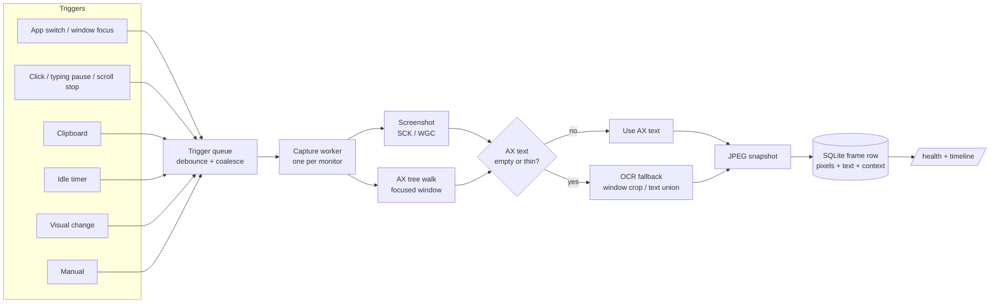

# How Screenpipe Works — Source Research

> Snapshot inspected: `/Users/dhruv/Work/screenpipe-sc`, app `v2.7.146`, workspace `0.4.58` (2026-11-08).
> Screenpipe is source-available under the **Screenpipe Commercial License**. This document is a behavioural study only. We will not copy its code; we will re-implement the mechanism independently using permissively licensed libraries.

---

## 1. TL;DR

Screenpipe is a local capture daemon + HTTP/WebSocket API + desktop app + AI feature layer.

The part we care about is its **screen-memory pipeline**:

```
UI event / idle timer / visual change
        │
        ▼
per-monitor capture loop (debounced)
        │
        ├─ screenshot of the monitor (ScreenCaptureKit / WGC)
        ├─ accessibility-tree walk of the focused window
        ├─ OCR fallback only if accessibility text is empty or "thin"
        ├─ write JPEG snapshot to disk
        └─ insert one SQLite row: pixels + text + app/window metadata + trigger
```

That is the whole mechanism. Everything else in Screenpipe — audio, meetings, video (HD recorder), search, pipes, agents, sync, telemetry, desktop UI — is built on top of it.

The biggest design lesson: **event-driven capture, not fixed-FPS recording.** A frame is a synchronized bundle of pixels + text + context, written once per meaningful user event. That is why it can be cheap enough to run all day.

---

## 2. Repository map (the files that matter)

| Area | File | What it does |
|---|---|---|
| Trigger taxonomy + loop | `crates/screenpipe-engine/src/event_driven_capture.rs` | Event triggers, debounce, per-monitor capture loop, dedup, screenshot scoping |
| Paired capture | `crates/screenpipe-capture/src/paired_capture.rs` | Screenshot + AX tree + OCR fallback + DB row in one operation |
| AX walker worker | `crates/screenpipe-capture/src/tree_walker_worker.rs` | Dedicated OS thread per monitor, timeouts, worker quarantine/recovery |
| macOS AX walk | `crates/screenpipe-a11y/src/tree/macos.rs` | Focused app → focused window → attribute walk → text/bounds/URL/document |
| UI events | `crates/screenpipe-a11y/src/platform/macos.rs` | CGEventTap, NSWorkspace observers, clipboard, permissions |
| Screen capture | `crates/screenpipe-screen/src/monitor/macos.rs` | ScreenCaptureKit capture with bounded calls + CoreGraphics fallback |
| Windows capture | `crates/screenpipe-screen/src/wgc_capture.rs` | Windows Graphics Capture |
| JPEG writer | `crates/screenpipe-screen/src/snapshot_writer.rs` | `data/YYYY-MM-DD/{ms}_m{monitor}.jpg` |
| OCR | `crates/screenpipe-screen/src/apple.rs`, `microsoft.rs`, `tesseract.rs` | Apple Vision / Windows OCR / Tesseract |
| OCR gate | `crates/screenpipe-capture/src/ocr_gate.rs` | Detect text regions, pixel-signature, skip unchanged OCR |
| DB schema | `crates/screenpipe-db/src/migrations/20260220000000_event_driven_capture.sql` | `frames` table with snapshot + text columns |
| PII regex | `crates/screenpipe-core/src/pii_removal.rs` | Inline regex redaction of emails, keys, cards, etc. |
| Redaction framework | `crates/screenpipe-redact/` | Text + image redaction, secrets-only default policy |
| Permissions | `crates/screenpipe-core/src/permissions.rs` | Tri-state TCC checks, live AX probe |
| Permission monitor | `crates/screenpipe-engine/src/permission_monitor.rs` | Poll + eager reports, lost/restored events |
| SDK core | `packages/sdk/recorder-core/src/platform/recorder.rs` | MP4 + paired-capture SDK orchestration |
| Node binding | `packages/sdk/src/lib.rs` | napi-rs surface |
| Tauri binding | `packages/sdk/tauri/rust/src/lib.rs` | Tauri v2 plugin |
| Event-driven spec | `docs/EVENT_DRIVEN_CAPTURE_SPEC.md` | Original design intent (historical; code has moved on) |

---

## 3. The recording mechanism in detail

### 3.1 Trigger layer

`CaptureTrigger` (`event_driven_capture.rs`) has these variants:

| Trigger | Source | Default |
|---|---|---|
| `AppSwitch` | macOS NSWorkspace activation | on |
| `WindowFocus` | AX focused-window notification | on |
| `Click` | CGEventTap / OS hook | on |
| `TypingPause` | aggregated text input | on |
| `KeyPress` | raw keystroke | off (privacy) |
| `ScrollStop` | scroll burst + quiet timer | on (macOS) |
| `Clipboard` | pasteboard change / Cmd-C | on |
| `VisualChange` | periodic screenshot diff | on, every 3s (engine + SDK) |
| `Idle` | timer | on, 30s engine / 15s SDK |
| `Manual` | explicit request | on |

The engine also has **workflow checkpoints** (key/clipboard) and **soft/hard debounce** logic:
- Hard checkpoints (`AppSwitch`, `WindowFocus`, `ScrollStop`, `Manual`) bypass normal throttles.
- Soft checkpoints (`KeyPress`, `TypingPause`, `Clipboard`) get a 1.5s floor so continuous typing does not become a capture storm.
- A minimum interval (default 200ms in the engine; 750ms in the SDK) prevents click bursts from saturating the pipeline.
- An idle fallback captures at a fixed cadence even when nothing happens.
- Meetings have a 5s idle floor so slides/screen-shares are not missed.

### 3.2 Per-monitor capture loop



`event_driven_capture_loop()` runs one loop per monitor. It:
1. Waits on a `broadcast::Receiver<CaptureTriggerMsg>` plus timers (idle, visual check, scroll-stop).
2. Drains/coalesces a burst of triggers into one capture. The most recent checkpoint wins; correlation IDs are accumulated so UI events can be linked to the eventual frame.
3. Applies debounce, content-hash dedup, and per-app throttles.
4. Runs `do_capture()`.
5. Records metrics and heartbeat (so `/health` can say "stale" instead of lying).

Key hot-path discipline in the source comments: **capture admission must never depend on OCR, DB, redaction, sync, or archival backlog.** If downstream work is slow, keep the recording and defer the work. This is the single most important reliability rule to copy conceptually.

### 3.3 Paired capture — the atomic unit

`paired_capture()` (`screenpipe-capture/src/paired_capture.rs`) does:

1. Write the JPEG snapshot to disk (unless screenshots disabled).
2. Decide text source:
   - If the AX tree has non-empty text → skip OCR.
   - If AX text is "thin" (toolbar/sidebar only) → OCR.
   - If the app is canvas-rendered (Figma, Photoshop, terminals, meeting screen-shares) → OCR.
   - If AX is empty → OCR.
3. OCR only the focused-window crop (or the detected text-region union) instead of the whole monitor.
4. Store one frame row with:
   - `snapshot_path`
   - `app_name`, `window_name`, `browser_url`, `document_path`
   - `accessibility_text` (flat text)
   - `accessibility_tree_json` (optional structured nodes)
   - `content_hash` + `simhash`
   - `capture_trigger`
   - `text_source` (`accessibility` / `ocr` / `hybrid`)
   - OCR text + per-box JSON in a child table
5. Redact PII (if enabled) before insert.
6. Commit OCR gate state only after the DB write succeeds.

This is a genuinely good idea: **pixels and text share one timestamp and one row**, so search results can never show a thumbnail from a different moment. The original spec calls this out as the fix for "wrong thumbnail" bugs.

### 3.4 Storage

- JPEGs: `~/.screenpipe/data/YYYY-MM-DD/{timestamp_ms}_m{monitor_id}.jpg`
- Default JPEG quality 80, optional max width (storage downscale).
- Metadata and text: SQLite `frames` table.
- Legacy frames may still point at H.265 video chunks; new frames point at a snapshot.
- Retention deletes old date directories and DB rows.

### 3.5 Dedup

Two layers:
- **Text content hash**: if the new AX text hash equals the previous frame's hash, skip the capture/DB row (unless enough time has passed, or the trigger is a hard checkpoint).
- **Visual frame comparison**: downscaled grayscale histogram + hash early-exit, used to decide if a periodic visual check should fire `VisualChange`.
- In event-driven mode this is mostly an optimization for idle/visual checks, not the primary capture gate.

### 3.6 Health

`/health` is intentionally non-blocking and reports realistic state: `ok`, `stale`, `degraded`, `disabled`, etc. It tracks last frame timestamp, capture attempts, OCR latency, and per-monitor liveness. The lesson for us: **status must be derived from real capture outcomes, not from "the loop is running".**

---

## 4. Screenshot mechanics

### 4.1 macOS

- Primary backend: **ScreenCaptureKit** via `sck-rs`.
- Capture is serialized through a mutex + a small semaphore because an SCK callback can wedge forever. Every call is bounded (12s capture timeout, 2s CoreGraphics fallback).
- After a timeout, the abandoned blocking task keeps its permit until it actually returns; the serializer can be released for one fresh attempt. This is deliberate containment, not a leak.
- Fallback: CoreGraphics (`xcap`) when SCK fails, but only when there are no window-exclusion requirements, because CoreGraphics cannot enforce exclusions. Privacy wins over availability.
- A persistent stream can return a stale buffer if the OS callback dies; they track a frame-delivery sequence to detect a frozen stream.

### 4.2 Windows

- Windows Graphics Capture (WGC), with WGC sessions kept alive for sustained recording.
- WGC can show a yellow capture border; on Windows 11 22H2+ apps can request borderless capture (with user consent and a package capability). On Windows 10 the border stays.

### 4.3 Monitors vs windows vs focused app

This is important because it is exactly our product requirement. Screenpipe has **three different things**:

1. **Full-monitor capture** (default): SCK/WGC captures the whole display.
2. **`--focused-window-screenshots`**: captures the full monitor, then paints everything outside the focused window **black**, keeping the original image dimensions. This preserves coordinate space for AX/OCR overlays. Missing focus/bounds → screenshots suppressed.
3. **Window capture** (`capture_screenshot_by_window.rs`): enumerates windows and captures each window's own pixels. This is mainly the legacy "per-window OCR / pipes" path, not the event-driven path.

There is also a dedicated `screenshot_privacy` module whose stated rule is: **window policies must constrain the source of pixels, not just frame metadata.** Filtered captures include only freshly verified window surfaces and never fall back to an unfiltered monitor capture. This is the right principle for our denylist and focused-app scoping: exclude at the compositor, not after the fact.

The SDK's paired capture uses **full-monitor capture** and does not even set focused-window mode; it attaches the focused AX tree to the monitor image. So Screenpipe today is not really "focused-app screenshots" by default.

Our requirement is stricter than Screenpipe's default. We need to decide among:
- **A. Display crop**: capture display, crop to focused window rect.
- **B. Display + app filter + crop**: capture display with only the focused app's windows composited, then crop. Other apps are blacked out at the compositor, not in post.
- **C. Window-only capture**: capture the focused window's own surface (ignores occlusion, may miss child windows/popovers).

I recommend **B as default**, **C as a strict mode**, and **A as a fidelity/raw mode**. Details in the plan.

### 4.4 Coordinate spaces

Screenpipe's AX walker reports window bounds normalized to the monitor's extent (0–1 fractions). The engine scales those fractions to the actual captured frame's pixel size. This handles Retina scaling and storage downscaling without hard-coding pixel coordinates. OCR boxes are stored in normalized image coordinates.

If we crop, we must store the window rect (screen points) + capture scale so we can map AX/OCR boxes back to a global screen position if we ever need overlays.

---

## 5. Accessibility text extraction

### 5.1 macOS walker

`crates/screenpipe-a11y/src/tree/macos.rs`:

1. Get system-wide AX element → focused application → focused window.
2. Enable Chromium/Electron AX tree materialization:
   - `AXManualAccessibility = true` (preferred)
   - `AXEnhancedUserInterface = true` (fallback)
   - Only once per PID per TTL; the flag is expensive and can disturb focus.
   - Wait ~150ms after enabling so the renderer can build the tree.
3. Read the window frame; walk children recursively.
4. For each element, read **batched** attributes (`AXRole`, `AXTitle`, `AXValue`, `AXDescription`, `AXPosition`, `AXSize`, `AXEnabled`, …). Batch reads matter: per-attribute IPC is the difference between 20ms and 500ms.
5. Extract text by role:
   - `AXTextField` / `AXTextArea` / `AXComboBox`: value
   - `AXStaticText`: value
   - fallback: title, then description
   - `AXSecureTextField`: skipped entirely (no value, no ancestor names)
6. Store structured nodes with role, text, depth, normalized bounds, `on_screen` flag.
7. Resolve browser URL:
   - `AXWebArea` URL, `AXDocument`, Arc-specific AppleScript fallback.
8. Resolve document path (`AXDocument` `file://`) for editors.
9. Budgets: **250ms** wall clock, **5000** nodes, **35** depth, **50k** chars, **200ms** per-element IPC timeout. Return partial results with a truncation reason.
10. Adaptive budgets per app: expensive apps (Electron, Discord) get fewer nodes/shorter timeouts.

They also have a **dedicated tree-walker worker thread per monitor** (`tree_walker_worker.rs`) because:
- Windows UIA is COM-thread-affine.
- macOS AX calls can hang; a watchdog times out the request and quarantines the worker.
- The capture loop must not be blocked by a hostile AX provider.

### 5.2 Windows

- UI Automation (UIA), on a dedicated COM thread.
- UIA calls are cross-process and serviced on the target app's UI thread; p95 can be 200ms+ and can freeze the foreground app. They explicitly note this in config comments and disable full-tree capture by default.
- Per-element timeouts and worker isolation are mandatory.

### 5.3 Snapshot shape

`TreeSnapshot` contains:
- `app_name`, `app_id` (bundle id), `executable`, `app_version`
- `window_name`, `browser_url`, `document_path`
- `text_content` (flat, newline-joined)
- `nodes` (role, text, depth, bounds, on_screen, …)
- `content_hash`, `simhash`
- `window_bounds` (normalized 0–1)
- `truncated`, `truncation_reason`, `walk_duration`, `node_count`

This is a good minimal shape for us. We do not need the semantic/automation/parser extensions.

---

## 6. OCR

### 6.1 Backends

| Platform | Backend | Notes |
|---|---|---|
| macOS | Apple Vision (`VNRecognizeTextRequest`) | Fast/accurate levels, language correction, bounding boxes |
| Windows | `Windows.Media.Ocr` | Language-pack dependent |
| Linux/fallback | Tesseract | External dependency |

Screenpipe's paired capture runs OCR on a blocking thread with a global semaphore (1 permit) so multi-monitor captures cannot spike CPU. On Windows, the wrapper already serializes native OCR.

### 6.2 OCR gate (cost control)

`screenpipe-capture/src/ocr_gate.rs` + `screenpipe-screen/src/text_regions.rs`:
1. Crop to the focused window.
2. Detect text regions cheaply.
3. Compute the padded union of those regions.
4. Compute a pixel signature of that union.
5. If the signature equals the last indexed one for this app → skip OCR and reuse cached text.
6. If changed → OCR only that union, not the whole frame.

This is a strong optimization: measured 4–5.5× cheaper on sparse content. It is more relevant for continuous polling than for event-driven capture, but it is useful for repeated idle captures of the same screen.

### 6.3 Text-source policy

- Accessibility first.
- OCR fallback only when AX is empty or thin.
- Hybrid when AX has chrome text and OCR has the real content.
- Some terminals always prefer OCR because their AX text is a raw buffer without visual layout.
- Meeting apps force OCR during calls because screen-share pixels have no AX tree.

### 6.4 PII/secret redaction at capture time

`paired_capture` calls `screenpipe_core::pii_removal::remove_pii()` on the flat text and OCR JSON **before DB insertion** when enabled. This is a single regex pass, not a model. The SDK hard-codes `use_pii_removal = true`; the engine defaults it off outside enterprise builds.

Important: this is **text-only**. The JPEG on disk is not redacted by this path.

---

## 7. UI events and permissions

### 7.1 macOS permission model

Screenpipe checks three independent things:

| Permission | API | Needed for |
|---|---|---|
| Screen Recording | `CGPreflightScreenCaptureAccess` / direct TCC probe / real capture | pixels |
| Accessibility | `AXIsProcessTrusted()` + live CGEventTap probe | AX tree, focused window, password-field detection |
| Input Monitoring | `CGPreflightListenEventAccess` / real listen-only event tap | clicks, keystrokes, scroll |

Notes from their code:
- `AXIsProcessTrusted()` caches in-process; a grant made while the app runs may not be visible until relaunch. Their live check uses an event-tap probe (only in the grant flow, because creating a tap while denied can enroll/prompt).
- A listen-only CGEventTap (Input Monitoring) is enough for triggers. An active tap needs Accessibility.
- `UiRecorder::start()` **hard-requires Accessibility** because it resolves focused app/window and click context. Without Input Monitoring it degrades: no click/keystroke events, but clipboard polling, app switches, and window focus still work via NSWorkspace/AX.
- macOS Sequoia+ periodically re-prompts for Screen Recording (roughly monthly) and there is no public opt-out. Their permission monitor handles lost/restored transitions and wake grace.

### 7.2 Event sources

- Mouse/keyboard: CGEventTap (macOS), low-level hooks (Windows), evdev/AT-SPI (Linux).
- App switch: NSWorkspace `didActivateApplicationNotification`.
- Window focus: AXObserver `kAXFocusedWindowChangedNotification`.
- Clipboard: NSPasteboard `changeCount` polling + worker thread, even without Input Monitoring.
- Text input: aggregated key events into "typing pause" bursts.
- Scroll: coalesced per gesture on macOS; Windows has its own aggregator.

### 7.3 Permission monitor

`permission_monitor.rs` is a good model:
- Poll every 5s as the baseline.
- Eager reports from capture modules when SCK returns `PermissionDenied` (within ~100ms).
- Deduplicate transitions in one state mutex.
- Suppress emissions for 10s after wake (TCC can transiently report denied).
- 5s cooldown per permission to avoid modal flashing.
- Emit `permission_lost` / `permission_restored` events.

---

## 8. Secret / PII redaction

Screenpipe has **two** redaction systems, and they are worth separating.

### 8.1 Inline regex redaction (`screenpipe-core/src/pii_removal.rs`)

- A `RegexSet` fast prefilter (one DFA pass) then targeted `replace_all`.
- Categories: credit cards, SSN, email, phone, IPv4, JWT, private-key blocks, DB connection strings, URLs with credentials, Stripe/OpenAI/Anthropic/Google/AWS/GitHub/GitLab/Slack/Discord/npm/PyPI/… keys, generic `api_key=`, `AUTHORIZATION=`, env secrets, IBAN, seed phrases, backup codes, password context, password dots.
- Replacement is a bracketed label, e.g. `[EMAIL]`, `[OPENAI_KEY]`, `[PASSWORD]`.
- Password context preserves the keyword and redacts only the value.
- `remove_pii_from_text_json` sanitizes only the `text` field of OCR boxes, preserving coordinates.
- This is cheap (<1ms typical) and deterministic.

### 8.2 Redaction framework (`screenpipe-redact`)

- **Text**: regex pre-pass always; optional AI fallback (Tinfoil enclave or local ONNX) for residual PII. Hash-cached. Graceful failure returns regex output, never raw input.
- **Policy**: `TextRedactionPolicy::default()` allows **only `SpanLabel::Secret`**. This is exactly the "only secrets" stance.
- **Image**: RF-DETR-Nano PII detector (optional ONNX/CoreML/DirectML) returns boxes; `frame_redactor` paints **solid black rectangles (not blur)** and destructively overwrites the source JPEG. It has a `secret_continuation` helper for secrets split across lines.
- **Workers**: background reconciliation loops over `ocr_text`, `audio_transcriptions`, `accessibility`, `ui_events`, and `frames`. Off by default. This is asynchronous because inline redaction costs 200–500ms/row and can stall on network/model failures.

**Critical observation for us:** Screenpipe's image redaction is destructive *after* the unredacted JPEG has already been written. There is a window where raw secrets exist on disk, and a crash can leave them there. If we promise "secrets redacted", we should redact **before** the final file is written, or write to a temp file and atomically move it after redaction.

### 8.3 What "secrets only" means in their code

`SpanLabel::Secret` is the default allow-list. That includes API keys, bearer tokens, passwords, private-key blocks. It does **not** include names, emails, phones, addresses, companies, etc. unless the user opts in. This matches our requirement well.

---

## 9. The existing Screenpipe SDK

There is already a `@screenpipe/sdk` (`packages/sdk`) with:
- **Node/napi** `Recorder` for MP4 recording.
- **Electron** wrapper: main-process IPC + preload + renderer events.
- **Tauri v2 plugin**: in-process Rust `Recorder`, no Node bridge.
- **Swift** package.

### 9.1 Current SDK surface

```ts
new Recorder({ output, monitorId?, mp4Monitors?, ignoredWindows?, includedWindows?, ignoredUrls?, ignoreIncognitoWindows?, enhancedIncognitoDetection?, dataDir?, pairedMonitors?, uiCapture? })
recorder.start()
recorder.stop()
recorder.snapshot()          // live JPEG preview of a monitor
recorder.framesWritten()     // MP4 frames
recorder.audioLevel()
recorder.filterStatus()
recorder.setFilters()
recorder.focusedApp()        // one AX walk
requestPermissions()         // screen + microphone only
```

### 9.2 How its paired-capture mode works

If `dataDir` is set:
- Opens SQLite at `{dataDir}/db.sqlite`.
- Writes JPEGs under `{dataDir}/data/`.
- Starts ONE `UiRecorder` for the whole process and bridges its crossbeam event stream into a tokio broadcast.
- Spawns one paired-capture loop per monitor. A click on monitor 1 produces a row on **every** monitor's loop (same trigger, same timestamp), so the DB records "what was on every screen at that moment".
- Constants: 750ms minimum gap, 15s idle, 3s visual check, 5% visual threshold, JPEG q70, max width 1280.
- Always enables PII removal.
- Accessibility walk and screenshot happen per trigger; full-monitor screenshot, no focused-window crop or mask.
- Paired-capture start failure is non-fatal (MP4 keeps recording).

### 9.3 Gaps vs. our needs

| Our need | Screenpipe SDK today |
|---|---|
| Start/stop a capture session | Yes, but MP4 is the default and paired capture is opt-in via `dataDir` |
| Focused-application screenshots | No: full monitor by default; focused mode exists in the engine but not exposed in the SDK |
| Event-triggered screenshots | Yes |
| OCR + accessibility text | Yes |
| Secrets-only redaction | Text regex only; image redaction is a separate heavy model and post-hoc |
| No server | Yes (SDK is in-process) but the SDK still carries MP4/ffmpeg and telemetry |
| Better permission APIs | Weak: only `{screen, microphone}`; microphone hard-coded `true`; no Accessibility/Input Monitoring state or request |
| Recent frames API | No. Only a live `snapshot()`. You read SQLite yourself. |
| Health checks | No. Only `framesWritten()`. |
| Small footprint | No: pulls audio, ffmpeg, server-adjacent deps, telemetry, enterprise license |

### 9.4 Packaging model

- napi-rs prebuilt binaries per platform (`darwin-x64`, `darwin-arm64`, `win32-x64-msvc`, `win32-arm64-msvc`).
- Optional dependencies per platform.
- Electron wrapper ships main/preload/renderer helpers.
- Tauri plugin is a normal Rust crate with `links = "screenpipe"` and generated v2 permissions.

This packaging model is a good reference. The technical approach (Rust core + napi for Electron/Node + Tauri plugin) is exactly right for us too.

### 9.5 What the server does (and why we skip it)

The screenpipe engine exposes ~48 route modules, including:

- `/health` — liveness/quality of capture, audio, DB, disk
- `/search` — keyword, semantic, hybrid search
- `/frames/:id`, `/frames/:id/thumbnail`, `/frames/:id/ocr` — frame metadata, pixels, OCR
- `/stream/frames` — WebSocket stream of new frames
- audio, meetings, speakers, transcription endpoints
- pipes/workflows/MCP/agent endpoints
- sync/cloud/auth endpoints

The SDK does **not** need any of this. It calls the recorder directly and exposes:
- `status()` instead of `/health`
- `getRecentFrames()` instead of `/frames`
- an in-process event emitter instead of `/stream/frames`
- no search in v1

This removes ports, auth, CORS, server lifecycle, and a large dependency tree.

---

## 10. What we should take, and what we should leave

### Take (conceptually, not code)

1. **Event-driven capture as the primitive.** One trigger → one synchronized frame + text row.
2. **Accessibility first, OCR as fallback.** Do not pay for OCR on every frame.
3. **Bounded everything.** Every native call has a timeout; every worker has a cap; a wedged AX/SCK call must not stall capture.
4. **Single writer, durable-first.** Persist pixels + metadata before optional enrichment.
5. **Focused-window scoping.** This is our core differentiator; do it properly.
6. **Rich permission state.** Screen / Accessibility / Input Monitoring as independent capabilities with degradation.
7. **Secrets-only deterministic redaction.** Cheap, local, explainable.
8. **Status derived from real outcomes.** Last frame, last error, queue depth, dropped reasons.
9. **Session-scoped storage.** Easy to export, delete, and reason about.

### Leave behind

- HTTP/REST/WebSocket server and `/health` endpoints.
- Audio capture, transcription, meetings, speakers.
- H.265/MP4/HD recorder/ffmpeg.
- Search/semantic indexing/local LLM/pipes/agents/MCP.
- Org sync, auth, cloud, telemetry, Sentry/PostHog.
- Full PII model pipeline (ONNX/Tinfoil/RF-DETR).
- Screenpipe's 30+ table schema and migration history.
- Multi-monitor-every-display default.
- The "record everything" philosophy. We record only the focused app, only on events.

---

## 11. Gotchas worth designing around

1. **macOS TCC is the product surface.** Screen Recording must be granted per app identity; dev builds change identity; Sequoia+ re-prompts monthly. If onboarding is bad, nothing else matters.
2. **AX can hang.** A hostile or busy app can block an AX call indefinitely. The walk must run on a disposable thread with a hard timeout and a bounded worker pool.
3. **Electron/Chromium AX is lazy.** Without `AXManualAccessibility`/`AXEnhancedUserInterface`, you get window chrome only. Enabling it per PID once is required, and it costs ~150ms the first time.
4. **Windows UIA is worse.** Cross-process UIA can freeze the foreground app. Do not walk the full tree by default; use timeouts, depth caps, and a dedicated COM thread.
5. **SCK can wedge.** A callback that never returns looks like a healthy thread. Bound every capture and treat "no frame" as failure.
6. **Screen capture and AX can disagree about focus.** Capture a focus token (PID + window title + bounds) before and after pixels/tree; discard if it changed. Do not attach an AX tree to the wrong monitor/window.
7. **Retina scaling.** AX bounds are in points, screenshots in pixels. Store both and convert once.
8. **OCR is not free.** 100–500ms per frame. Skip it when AX is good, crop to the window/text union, and never let it block frame persistence.
9. **Secrets are in pixels, not just text.** Text-only redaction leaves the secret visible in the JPEG. Decide explicitly whether "redacted" means text or text + pixels.
10. **Password fields are special.** `AXSecureTextField` values must never be read; the field region should be blacked out. macOS secure input mode (`IsSecureEventInputEnabled`) should pause capture entirely.
11. **Do not log captured text.** Logs are the easiest place to leak a secret.
12. **The monthly screen-recording prompt is not a bug.** Design onboarding and degraded states for it.

---

## 12. Confidence and caveats

**Verified by reading the source in this snapshot:**
- trigger taxonomy, debounce, coalescing, per-monitor loop
- paired capture flow and DB columns
- JPEG snapshot layout
- macOS AX walk behaviour (Electron flags, batched reads, budgets, URL/document extraction)
- macOS permission checks and the event-tap/input-monitoring split
- OCR fallback policy and OCR gate
- inline PII regex and the `screenpipe-redact` secrets-only policy
- existing SDK surface and packaging model

**Taken from their docs/comments, not independently measured here:**
- CPU/OCR latency and storage numbers
- Windows UIA latency/freeze claims
- monthly macOS screen-recording re-prompt cadence (Apple does not document it; the ~monthly behaviour is widely reported)
- WGC borderless behaviour on specific Windows builds

**Not verified at all:**
- real-world accuracy of their OCR on our target apps
- Windows behaviour on actual hardware
- legal/marketplace constraints of distributing a screen-capture SDK

Screenpipe moves quickly; function names and line numbers will drift. The mechanisms above are stable, the details are not.

---

## 13. What this means for our product (one paragraph)

We should build a **focused-app, event-driven capture SDK**, not a mini-Screenpipe. The core is a small Rust engine with four responsibilities: (1) watch the focused app and user events, (2) capture a window-scoped JPEG on meaningful events, (3) extract accessibility text and fall back to OCR, (4) redact secrets before anything is persisted. It should expose start/stop/status/recent-frames/permissions through a native Node addon for Electron and a Rust/Tauri plugin, with no server, no video, no audio, and no cloud. The hard parts are permission UX, focus coherence, AX reliability, and redaction correctness — not the screenshot call itself.
